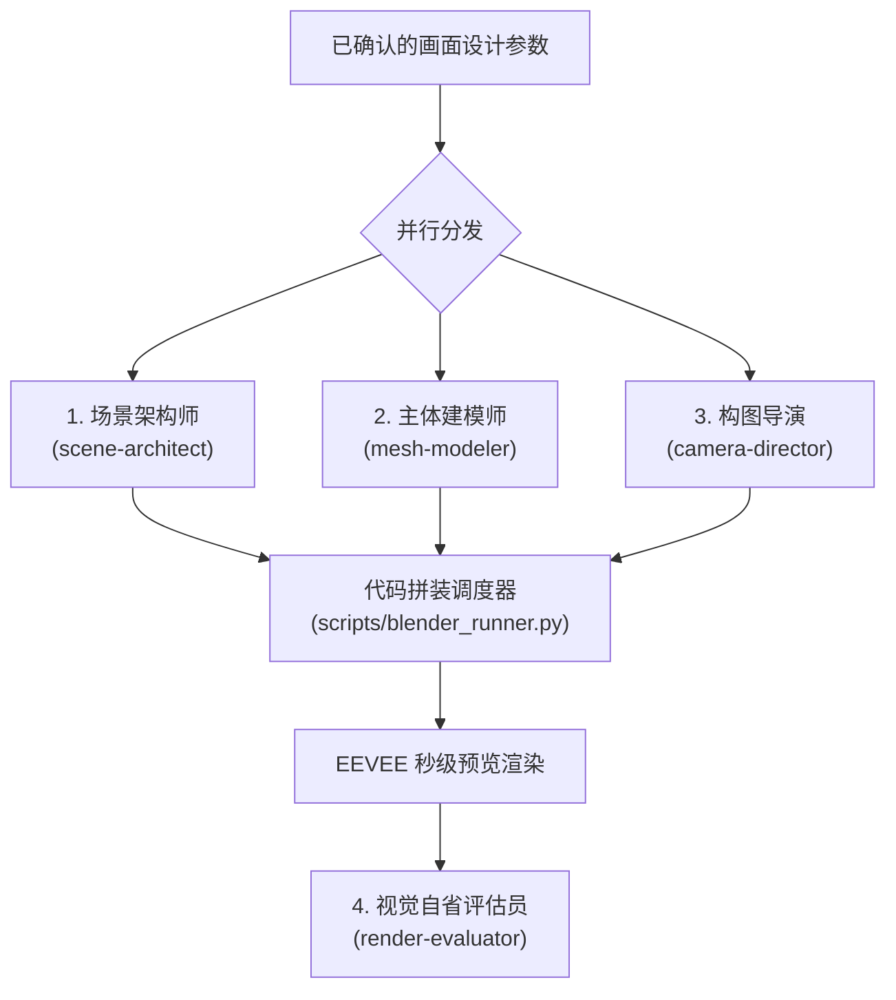

# Vibe-Modeler：自动化 3D 唯美场景建模

`Vibe-Modeler` 专为“**完全随机灵感激发 -> 最简人机选择 -> Blender 自动化唯美场景建模 -> 多维度自省纠偏 -> 偏好沉淀 -> 增量自然语言改图**”而设计。
无论用户是否懂 3D 技术，都能通过最直观的选择，由多个并行 Subagent 在 Blender 中构建出壁纸级的唯美 3D 场景，并在渲染后通过对话继续精修。

---

## 一、微缩“说人话”交流守则（全程强制生效）

与用户沟通时，严格遵循内嵌的 [`references/shuorenhua.md`](references/shuorenhua.md) 规则：

1. **像懂审美的朋友一样说话**：语言自然平实，严禁“值得注意的是”、“正如我们所知”、“综上所述”、“赋能”、“闭环矩阵”等公文或 AI 腔套话。
2. **通俗大白话为主 + 括号标注专业术语**：
   - 谈景深时：写“背景虚化明显，主角格外突出（大光圈景深 F1.8）”
   - 谈画幅时：写“电影宽银幕视界（2.35:1 宽画幅）”或“壁纸宽屏（16:9）”
   - 谈光影时：写“边缘镀上一层发光的金边（轮廓光 Rim Light）”
   - 谈材质时：写“微透微润的玉石质感（次表面散射 SSS）”或“清爽二次元色块（赛璐珞着色）”
3. **拒绝华丽辞藻堆砌，坚持平铺直叙的画面感**：
   - 严禁使用“宿命感”、“流淌的梦境”、“浩瀚穹苍的神圣挽歌”等玄虚大词。
   - 坚持用朴素语言描摹物象（如“雨后积水反光的小马路”、“海边撑起的一把折叠椅”、“桌角斜照进来的阳光”），用场景本身的真实纯粹唤起惊喜。
4. **改图提问铁律：有疑必问，绝不自作主张臆测需求**：
   - 用户提出任何后续修改意见时，严禁盲猜其意图，必须先拆解关键疑问并通过 `ask_question` 确认清楚再动手。

---

## 二、三阶段递进式人机引导流程

当用户触发场景建模时，通过 `ask_question` 渐进式展开 3 个轻量问题（附带 Recommended 推荐项）：

### 第 1 步：灵感盲盒与大风格
- **画面大风格**：
  - `(Recommended) 唯美二次元/轻卡通（日漫赛璐珞质感、线条清爽明丽）`
  - `写实电影感（细腻 PBR 材质、真实光线追踪光影）`
- **随机灵感盲盒（遵循【三元结构】推荐 3 个朴素而有张力的选项）**：
  - 参考 [`references/inspiration_seeds.md`](references/inspiration_seeds.md)，必须按以下三元结构组合，严禁玄虚修辞：
    - `选项 1（轻美学主题型）：【日系清爽】晴天海边的小水泥码头，一根系船桩，远处天上有几朵干净白云`
    - `选项 2（平铺直叙生活/自然型）：【窗台午后】一张浅木色小书桌，放着一杯冒微温的白瓷茶杯，斜阳刚好照在杯沿`
    - `选项 3（质朴奇幻微缩型）：【浮空石头】一块飘在半空的青苔大石头，顶上长着一棵弯曲的小树苗，周围悬浮几颗小碎石`

### 第 2 步：画面主体与场景舞台
- **画面核心主角（多选一）**：
  - 提供 3 个围绕选定关键词的视觉主体（如：孤立白色小灯塔 / 半透明发光水晶簇 / 木质悬空小凉亭）
- **场景环境舞台（多选一）**：
  - 提供 3 个搭配的环境（如：如镜面般平整的浅滩倒影 / 长满苔藓的微起伏岩石地表 / 傍晚微风吹拂的草坡）
- **文字补充（完全自愿）**：提示用户“如果脑海中有特别想要的小细节，可以发一句话，没有的话直接回车跳过”。

### 第 3 步：光影视效与镜头构图
- **主题色调**：
  - `(Recommended) 温暖治愈系（日落金橙色 + 柔和暖金主光）`
  - `清冷静谧系（月夜靛蓝 + 清澈青冷光）`
  - `赛博双色系（青蓝主光 + 品红发光轮廓）`
- **明暗反差**：
  - `(Recommended) 柔和通透（空气感薄雾、层次细腻柔美）`
  - `高反差硬朗（戏剧化明暗交割、立体雕刻感）`
- **画面比例与镜头**：
  - `(Recommended) 16:9 壁纸画幅 + 黄金分割构图（背景微虚化）`
  - `21:9 电影宽画幅 + 低角度仰拍（宏大震撼感）`
  - `1:1 方形头像画幅 + 微距特写（浅景深特写聚焦）`

---

## 三、引擎模式选择与环境探测

在开始建模前，调用探测脚本判断环境并让用户选择：
```bash
python scripts/blender_finder.py --json
```
- 若用户选择 **【后台静默运行（CLI 模式）】**：
  使用全自动脚本拼装，执行无头渲染并生成 `.png` 和 `.blend` 文件。
- 若用户选择 **【Blender 窗口实时联动（RPC 模式）】**：
  检查 `http://127.0.0.1:9876/status`，通过 RPC 接口将建模命令实时推送到打开的 Blender 窗口。

---

## 四、多 Subagent 并行协作与几何节点能力

由主控 Agent 拆解任务，并行调度 3 个生成型 Subagent 生成模块化 bpy 脚本片段：



### 1. 场景与布光架构师 (`scene-architect`)
- **世界环境与天空**：设置渐变穹顶天空（`setup_procedural_sky`）或体积雾气散色（`create_volumetric_fog`）。
- **电影感三点布光**：
  - 主光（Key Light）：45° 侧照，带冷暖倾向。
  - 辅光（Fill Light）：柔和暗部填充。
  - 轮廓光（Rim Light）：后上方勾勒高亮边缘，分离主体与背景。
- **程序化地貌生成**：引入几何节点起伏地貌（`templates/geo_nodes.py` 中的 `apply_gn_terrain_displacement`），利用程序化噪声直接让网格产生自然的微山峦起伏。

### 2. 主体与配景建模师 (`mesh-modeler`)
- **程序化几何体构建**：使用 bpy / bmesh 构建主体结构。
- **倒角圆润化**：严禁出现正交生硬尖角，所有结构添加 Bevel 或 Subdivision 倒角修改器。
- **几何节点程序化散布与微粒（Geometry Nodes）**：
  - 调用 `templates/geo_nodes.py` 中的 `apply_gn_surface_scatter` 在地面/岩石表面程序化随机散布草簇、碎石、小野花或碎水晶（带随机 Z 轴旋转与缩放）。
  - 调用 `apply_gn_floating_motes` 在主体周围生成半空中浮动的发光微尘/萤火微粒。
- **高级唯美着色器**：
  - 卡通风格使用双色阶赛璐珞 + Fresnel 边缘发光着色器（`create_procedural_toon_material`）。
  - 水晶/玉石使用透明玻璃 + 次表面散射 + 发光混合。
  - 按需加载 CC0 纹理贴图（调用 `scripts/asset_loader.py`）。

### 3. 构图与运镜导演 (`camera-director`)
- **相机机位与目标追踪**：创建 Camera，利用 `Track To` 约束对准主体。
- **构图法则**：将主体放置在三分线经纬交叉点（而非呆滞正中），预留 30% 以上的纯净负空间。
- **景深与焦段**：开启 `dof`（Depth of Field），焦距依据预设设定（50mm / 85mm / 28mm），光圈 F1.8~F4.0。

---

## 五、视觉自省评估员与纠偏闭环 (`render-evaluator`)

1. **秒级低清预览渲染**：
   通过 `blender_runner.py` 调度 EEVEE 引擎在 800x600 分辨率下渲染预览图（通常耗时 1~2 秒）。
2. **多模态看图自省（Agent Visual Inspection）**：
   Agent 使用 `read_file` 查看生成的预览图，检查以下致命瑕疵：
   - **曝光平衡**：画面是否存在大面积死黑（漏光）或高光过曝（纯白死光）？
   - **主体构图**：主体是否被裁切出画、过小看不清，或与摄像机穿模？
   - **色彩协调**：冷暖对比是否符合用户设定的色调基调？
3. **参数微调补丁**：
   若发现问题，生成微调补丁脚本（微调摄像机位置、灯光强度或材质参数），重新快速渲染确认（自省微调最多进行 1~2 轮）。
4. **最终高清出图**：
   自省达标后，按风格自动选用 EEVEE-Next（卡通）或 Cycles（写实高精度）输出最终壁纸分辨率成品渲染图及 `.blend` 工程文件。

---

## 六、多维打分、偏好沉淀与决策图交付

渲染完成后，向用户呈现最终成品并执行闭环收尾：

### 1. 用户 4 维度打分
使用 `ask_question` 邀请用户进行轻量 1~5 星打分：
- **唯美氛围感**（Overall Atmosphere）：场景的意境与情调
- **主体造型感**（Subject & Geometry）：核心物体的几何外形与细节
- **色彩光影感**（Color & Lighting）：冷暖调和与明暗层次
- **构图运镜感**（Composition & Camera）：画面裁剪与视角张力

### 2. 更新本地用户美学画像
调用 `scripts/profile_manager.py` 的 `record_session()`：
- 自动更新 `user_profile.json` 中的美学权重（冷暖偏好、对比度偏好、卡通 vs 写实偏好）。
- 下次启动生成时，优先基于用户沉淀的偏好推荐预设选项。

### 3. 输出决策链路时序图与美学解读
生成完整的 Mermaid 决策图，并附带一份自然亲切的美学总结。

---

## 七、自然语言继续改图回路（严禁盲猜，有疑必问）

当用户在初次生成后提出修改意见时，启动增量精修流程：

### 1. 严格澄清需求（Never Guess!）
**千万不要在信息模糊时直接猜用户的意图**。任何模糊词语（如“调暗点”、“换个颜色”、“加点东西”、“太空了”）都必须提炼成具体的分歧点，并调用 `ask_question` 进行澄清：
- **案例 A：用户说“把光调暗一点”**：
  - 提问：“关于把光调暗，你期望调整的范围和幅度是？”
  - 选项 1：`(Recommended) 仅将主体受光削弱约 40%，背景天空与整体环境保持明亮`
  - 选项 2：`整体天色压暗为日落傍晚（天光转深蓝或金橙暗部，增加阴影面积）`
  - 选项 3：`完全转入夜景月光氛围（以冷月光与局部点缀微光为主，大对比度）`
- **案例 B：用户说“加点水面”**：
  - 提问：“关于添加水面，你希望水面的形态与覆盖范围是？”
  - 选项 1：`(Recommended) 镜面平静浅水滩（倒映天空和主体，覆盖大部分地表）`
  - 选项 2：`带微风波光的水面（程序化微波浪起伏，带高光细碎闪烁）`
  - 选项 3：`仅在低洼处留有一两个积水倒影坑（保留大部分干爽地面）`

### 2. 增量局部打补丁（Incremental Patch）
- 用户确认意图后，不要推倒重构整个场景，而是利用 `scripts/blender_runner.py` 的 `run_incremental_patch(base_blend_path, patch_code, render_settings)`，在现有 `.blend` 工程基础上对特定灯光对象、材质节点或相机进行定向微调并快速重新渲染。
- 渲染完成后向用户展示前后对比成果，直至用户满意。
